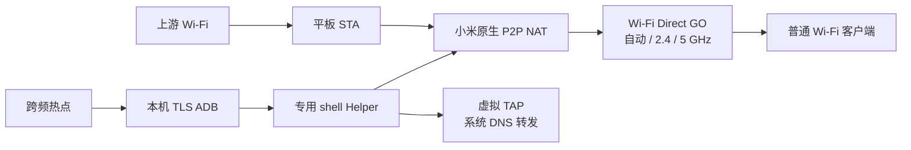

# 跨频热点 · CrossBandHotspot

[](https://github.com/RTXwcz/CrossBandHotspot/actions/workflows/build.yml)
[](LICENSE)

**平板连接5GHz Wi-Fi，同时开启可选择频段的热点。配置一次，重启后直接在平板启动。**

Android Wi-Fi sharing with selectable Auto / 2.4 GHz / 5 GHz bands and on-device recovery after reboot.

当前针对 **小米平板7、Android16、HyperOS3** 实现并实测。使用小米ROM自带的P2P共享接口，兼容范围见[验证记录](docs/validation.md)。

## 下载与使用

从 [Releases](https://github.com/RTXwcz/CrossBandHotspot/releases/latest) 下载APK安装。

1. 平板连接上游Wi-Fi，打开“跨频热点”。
2. 首次点“配置免电脑启动”，完成下方的本机配对。
3. 选择**自动 / 2.4 GHz / 5 GHz**，设置名称、密码，点击“启动热点”。
4. 其他设备按普通Wi-Fi连接，地址和DNS自动获取，无需代理或客户端应用。

运行中更换频段后点“应用设置并重新启动”；点“停止热点”关闭共享。重启后，连接Wi-Fi，再打开应用选择频段并启动即可。

热点名称带有Wi-Fi Direct规定的`DIRECT-CB-`前缀。公开版首次安装会生成随机密码，已保存的配置会继续使用。

## 首次配对，全程在平板完成

1. 在配置页点“打开系统无线调试设置”，打开开发者选项中的“无线调试”。确认系统的当前网络授权。
2. 将系统设置和应用配对页**分屏或小窗显示**。
3. 点系统的“使用配对码配对设备”，保持窗口打开。
4. 在应用中输入六位配对码，点“配对并保存”。
5. 显示配置完成后返回热点页。

标准Android通知也提供配对码输入。本机HyperOS通知样式隐藏了这个按钮，实测可用的入口是应用内分屏/小窗配对。

应用保存本机配对身份，并通过本机ADB授予`WRITE_SECURE_SETTINGS`。之后点击启动时，应用按需重开无线调试并恢复固定用途的共享后台。无需Root。换到未信任的Wi-Fi接入点时，在平板上确认系统网络提示即可；系统撤销配对后，也可按上述步骤重新配置。

## 已实现

- 5GHz上游 + 2.4GHz热点，以及5GHz上游 + 5GHz热点。
- 自动、2.4GHz、5GHz三档选择；上游为5GHz时，5GHz热点采用上游当前信道。
- 透明IPv4共享、自动DHCP和DNS。
- 重启后由应用在平板本机恢复共享后台。
- 前台服务、状态通知、名称与密码保存、停止和重建无线组。

## 构建

需要 **JDK17+、Python3.10+、Android SDK Platform37.0、Build Tools36.0.0**。运行时最低Android16/API36，当前APK包含arm64原生库。

```sh
sdkmanager "platforms;android-37.0" "build-tools;36.0.0"
python app/build.py --sdk /path/to/Android/Sdk
```

已设置`ANDROID_HOME`或`ANDROID_SDK_ROOT`时，可直接执行：

```sh
python app/build.py
```

脚本按`app/dependencies.lock.json`下载并校验固定版本依赖，执行`javac`、`d8`、`aapt2`与签名验证。产物为`app/build/CrossBandHotspot.apk`。首次构建会在本机生成开发签名密钥，已存在时复用；CI产物使用各次任务的开发签名。

自定义签名可使用`--keystore`、`--alias`，密码通过`CROSSBAND_STORE_PASSWORD`与`CROSSBAND_KEY_PASSWORD`环境变量传入。

## 工作原理



无线组由公开`WifiP2pManager`接口管理；Helper调用ROM的`MiuiWifiService`并持有虚拟TAP共享请求。Helper只提供密钥认证的`start/stop/status`，监听本机回环地址。

**切频只重建无线组，保留NAT/TAP会话。** 小米的停止共享接口会停止全局DNS，而系统共享状态机可能仍保持活动；误把切频中的临时断组当作停止，会导致热点能连但DNS超时。实现与来源见[架构说明](docs/architecture.md)。

## 开源许可与致谢

本项目采用 **GPL-3.0-or-later**，见[LICENSE](LICENSE)。

本机ADB使用[MuntashirAkon/libadb-android](https://github.com/MuntashirAkon/libadb-android)，恢复流程参考[mouldybread/adb-auto-enable](https://github.com/mouldybread/adb-auto-enable)。SPAKE2、Conscrypt、Bouncy Castle及证书库的版本、源码与许可见[第三方声明](THIRD_PARTY_NOTICES.md)。Releases附带相关依赖的对应源码包。
